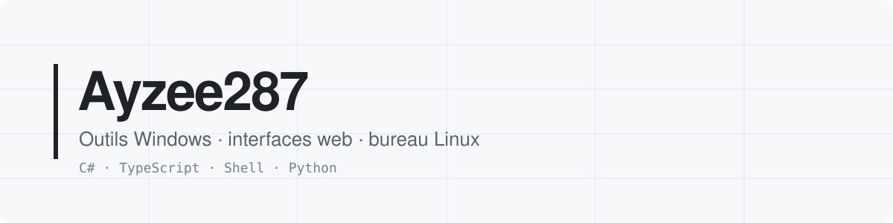
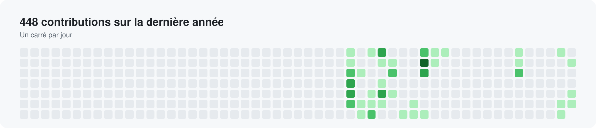
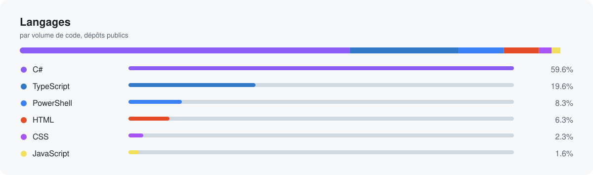

<picture>
  <source media="(prefers-color-scheme: dark)" srcset="assets/banner-fr-dark.svg">
  
</picture>

📍 France &nbsp;·&nbsp; 🌐 [English](README.md) · Français

## Projets choisis

<table>
<tr>
<td width="50%" valign="top">

### [Mesura](https://github.com/Ayzee287/Mesura)
Installer et optimiser Windows 10/11 : réglages vérifiés avec aperçu et annulation, applications, configurations, profil de pilote NVIDIA. Anglais et russe.

`C#` `WPF` `Windows` · MIT

</td>
<td width="50%" valign="top">

### [umbra-plasma](https://github.com/Ayzee287/umbra-plasma)
Une couche monochrome sobre pour KDE Plasma 6 : états d'interaction neutres, style Plasma généré, sauvegarde et retour arrière complets.

`Shell` `KDE Plasma` · MIT

</td>
</tr>
<tr>
<td valign="top">

### [knu-chemistry-site](https://github.com/Ayzee287/knu-chemistry-site)
Plateforme moderne d'enseignement de la chimie, construite avec Next.js et Tailwind CSS. [En ligne](https://knu-chemistry-site.vercel.app)

`TypeScript` `Next.js` `Tailwind` · MIT

</td>
<td valign="top">

### [adamenko-photography-site](https://github.com/Ayzee287/adamenko-photography-site)
Portfolio de photographie. [En ligne](https://adamenko-photography.com)

`TypeScript`

</td>
</tr>
</table>

Aussi : [knu-physical-chemistry-site](https://github.com/Ayzee287/knu-physical-chemistry-site) · [ai-studio-infra](https://github.com/Ayzee287/ai-studio-infra), un environnement Claude Code reproductible (serveurs MCP, plugins, skills).

## Activité

<picture>
  <source media="(prefers-color-scheme: dark)" srcset="assets/activity-fr-dark.svg">
  
</picture>

<picture>
  <source media="(prefers-color-scheme: dark)" srcset="assets/languages-fr-dark.svg">
  
</picture>

## Stack

