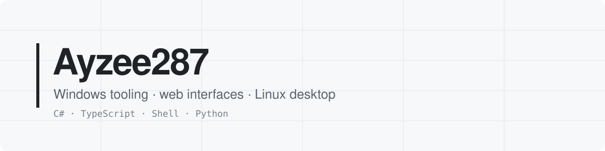
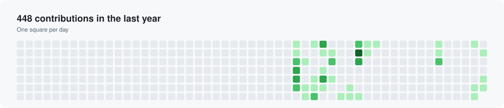
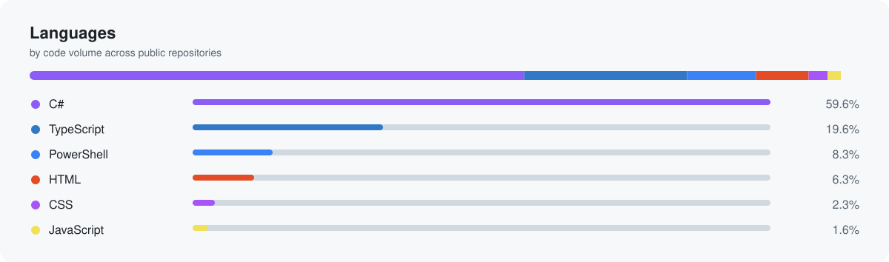

<picture>
  <source media="(prefers-color-scheme: dark)" srcset="assets/banner-dark.svg">
  
</picture>

📍 France &nbsp;·&nbsp; 🌐 English · [Français](README.fr.md)

## Selected work

<table>
<tr>
<td width="50%" valign="top">

### [Mesura](https://github.com/Ayzee287/Mesura)
Set up and tune Windows 10/11: reviewed settings with preview and undo, apps, app configs, NVIDIA driver profile. English and Russian.

`C#` `WPF` `Windows` · MIT

</td>
<td width="50%" valign="top">

### [umbra-plasma](https://github.com/Ayzee287/umbra-plasma)
A restrained monochrome layer for KDE Plasma 6: neutral interaction states, generated Plasma style, full backup and rollback.

`Shell` `KDE Plasma` · MIT

</td>
</tr>
<tr>
<td valign="top">

### [knu-chemistry-site](https://github.com/Ayzee287/knu-chemistry-site)
Modern chemistry education platform built with Next.js and Tailwind CSS. [Live](https://knu-chemistry-site.vercel.app)

`TypeScript` `Next.js` `Tailwind` · MIT

</td>
<td valign="top">

### [adamenko-photography-site](https://github.com/Ayzee287/adamenko-photography-site)
Photography portfolio. [Live](https://adamenko-photography.com)

`TypeScript`

</td>
</tr>
</table>

Also: [knu-physical-chemistry-site](https://github.com/Ayzee287/knu-physical-chemistry-site) · [ai-studio-infra](https://github.com/Ayzee287/ai-studio-infra), a reproducible Claude Code environment with MCP servers, plugins and skills.

## Activity

<picture>
  <source media="(prefers-color-scheme: dark)" srcset="assets/activity-dark.svg">
  
</picture>

<picture>
  <source media="(prefers-color-scheme: dark)" srcset="assets/languages-dark.svg">
  
</picture>

## Stack

